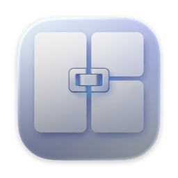
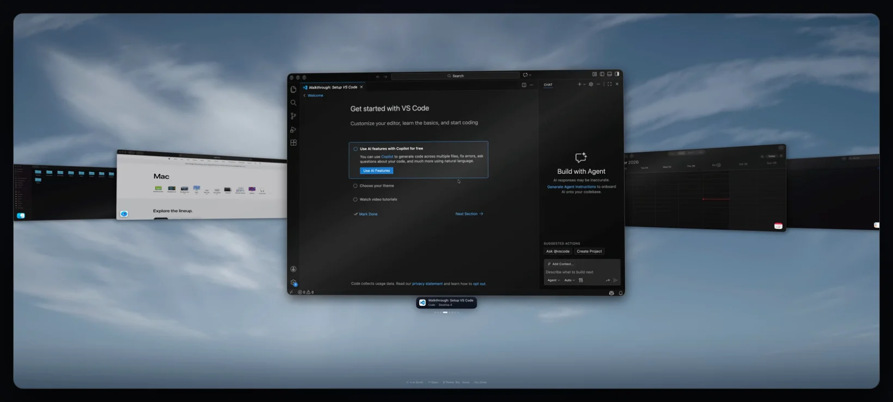

<p align="center">
  
</p>

<h1 align="center">Rapto</h1>

<p align="center">
  A tiling window manager for macOS: ready-made and custom layouts, automatic tiling,<br>
  keyboard shortcuts, window groups and a bar that shows every desktop.
</p>

<p align="center">
  <a href="https://rapto.app">Website</a> ·
  <a href="https://rapto.app/download">Download</a> ·
  <a href="https://rapto.app/docs">Documentation</a> ·
  <a href="https://rapto.app/changelog">Changelog</a>
</p>

<p align="center">
  
</p>

Rapto is free and open source, with no trial, subscription or license key. Most people should simply
[download the app](https://rapto.app/download); this repository is for those who want to
read the code, build it themselves or contribute.

## Features

- **Four modes, chosen per display and per desktop.**
  - *Drag to Snap*: snap dragged windows to the screen edges, the top bar or a layout. Drop
    several in one zone to group them.
  - *Manual*: pick a layout for the desktop, and Rapto keeps current and new windows in its
    slots.
  - *Auto Tiling*: Rapto switches layouts on its own as windows open and close, and groups
    any extras.
  - *None*: Rapto stays out of the way on that desktop.
- **Layouts.** A set of standard layouts, plus an editor for drawing your own right on the
  screen.
- **Window groups.** Several windows share one slot and you cycle through them.
- **Desktops Bar.** See every desktop and what is open on it, switch with a click and drag
  apps between desktops.
- **Workspaces.** Save the apps you use for a task and where each window goes, then bring
  them all back or close them all at once.
- **Keyboard shortcuts** for layouts, moving and swapping windows, focusing a slot and
  switching desktops, with a Vim-style preset.
- **Window switcher**, resizing neighbours together, swapping by drag, floating windows and
  a focus mode.
- **Multiple displays** with independent settings.
- **AppleScript commands**, used by the Rapto extension for Raycast.

## Requirements

- macOS 26 or later, Apple Silicon or Intel.
- **Accessibility** permission, to move and resize windows.
- **Screen Recording** permission, optional: it lets Rapto show live previews of your windows
  in the layout overlay and match the highlight border to each window's corners. The images
  stay in memory and are never saved or uploaded.

## Privacy

Rapto works entirely on your Mac. It has no servers, accounts, analytics or crash
reporting. The only network request is the update check ([Sparkle](https://sparkle-project.org)
downloads a small feed file from GitHub). The full policy is at
[rapto.app/privacy](https://rapto.app/privacy).

## Private macOS APIs

macOS has no public API for desktops (Spaces), so Rapto, like other window managers, calls a
small set of undocumented system functions. They are declared at the top of the files that
use them, mainly `SpaceBarController.swift`, `SpaceManager.swift`, `DockSpaceSwipe.swift` and
`WindowTitleResolver.swift`:

| Functions | Used for |
| --- | --- |
| `CGSMainConnectionID`, `CGSCopyManagedDisplaySpaces`, `CGSGetActiveSpace`, `CGSCopySpacesForWindows` | Listing desktops, finding the current one and the desktop a window is on |
| Synthetic Dock swipe events | Switching desktops |
| `CGSGetSymbolicHotKeyValue`, `CGSIsSymbolicHotKeyEnabled`, `CGSSetSymbolicHotKeyEnabled` | Reading and toggling the system desktop shortcuts |
| `_AXUIElementGetWindow`, `_AXUIElementCreateWithRemoteToken` | Matching an Accessibility window to its window number, and reaching windows on other desktops to read their titles |
| `GetProcessForPID`, `_SLPSSetFrontProcessWithOptions` | Bringing one window of an app to the front without its other windows |
| `SLSMainConnectionID`, `SLSWindowIsOrderedIn` | Checking whether a window is shown on the current desktop |
| The `CGSSessionScreenIsLocked` key of the session dictionary | Screen lock state |

These functions can change in any macOS release. Places where Rapto works around system
behaviour are marked in the code with `// MARK: - Workaround:` and a short explanation.
Because of these calls and because it controls other apps' windows, Rapto is not sandboxed
and cannot be distributed through the Mac App Store.

## Building from source

You need Xcode 26 or later (checked with Xcode 26.6 and 27.2).

```bash
git clone https://github.com/LevkaDev/Rapto.git
cd Rapto
cp Config/Signing.local.xcconfig.example Config/Signing.local.xcconfig   # then put your team ID in it
open Rapto.xcodeproj
```

Select the `Rapto` scheme and run. The Debug configuration builds **Rapto Debug**
(bundle ID `app.rapto.mac.debug`), which has its own settings and permissions and can be
installed next to the released app.

- **Signing.** Your Apple Developer Team ID goes in `Config/Signing.local.xcconfig`, which
  git ignores; the project file itself holds no team, so do not set one in Xcode's
  *Signing & Capabilities*. A free Apple ID is enough. macOS ties the Accessibility and
  Screen Recording permissions to the app's signature, so sign with your team; the example
  file also shows ad-hoc signing, with which macOS asks for the permissions again after
  every build. All of this is for the Debug configuration. Release is signed with a
  Developer ID certificate; without one, build it unsigned by adding
  `CODE_SIGNING_ALLOWED=NO` to the `xcodebuild` command.
- **Dependencies.** Sparkle is fetched by Swift Package Manager on the first build.
- **Tests.** Run the `RaptoTests` target (`⌘U`). The tests start a second copy of the
  app, so quit Rapto Debug first.
- **Logs.** `~/Library/Logs/Rapto/debug.log` when file logging is turned on in Settings, or
  `log stream --predicate 'subsystem == "app.rapto.mac"'`.

`build.sh` and `release.sh` produce the signed, notarized release and publish it. They are
only useful to maintainers; see `release.local.env.example`.

## Contributing

Bug reports and pull requests are welcome. Please read [CONTRIBUTING.md](CONTRIBUTING.md)
first, and run `git config core.hooksPath .githooks` once in your clone: the hooks keep
build output, local settings and personal data out of commits. If you work with an AI
coding agent, its rules are in [AGENTS.md](AGENTS.md). To report a security problem, see [SECURITY.md](SECURITY.md).

## Acknowledgements

- Instant desktop switching is based on
  [InstantSpaceSwitcher](https://github.com/jurplel/InstantSpaceSwitcher) by jurplel (MIT).
  Thank you. Its license notice is in [THIRD_PARTY_NOTICES.md](THIRD_PARTY_NOTICES.md).
- Updates are delivered with [Sparkle](https://sparkle-project.org).
- Inspired by [Amethyst](https://github.com/ianyh/Amethyst) and
  [Raycast](https://www.raycast.com) (carrying a window to another desktop by holding its
  title bar) and by [Hammerspoon](https://www.hammerspoon.org) (adding a desktop through
  Mission Control).

## License

Rapto is free software: you can redistribute it and modify it under the terms of the
[GNU General Public License](LICENSE) as published by the Free Software Foundation, either
version 3 of the License or, at your option, any later version (`GPL-3.0-or-later`). It
comes with no warranty.

The name "Rapto" and the Rapto icon are trademarks of the author and are not covered by
that license. If you distribute a modified version, please give it a different name and
icon.
